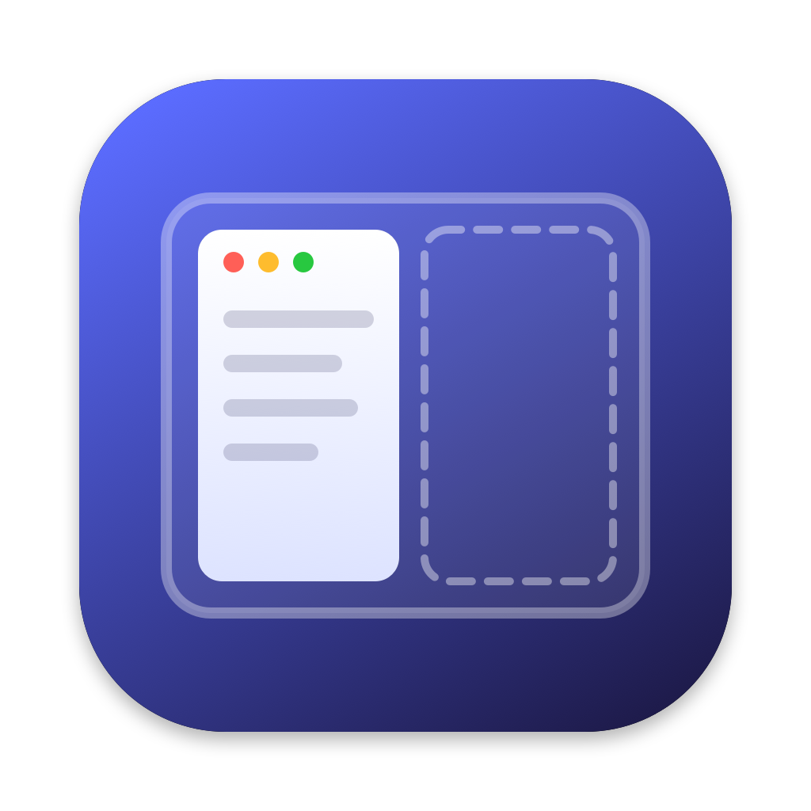

<p align="center"></p>

# Snap

A menu bar app for snapping windows on macOS 13 and later.

| Shortcut | Action |
| --- | --- |
| `⌃⌥←` (Control–Option–Left) | Fill the left half of the screen’s usable area |
| `⌃⌥→` (Control–Option–Right) | Fill the right half of the screen’s usable area |
| `⌃⌥↑` (Control–Option–Up) | Fill the screen’s usable area |

Snap moves the focused window. It uses the screen that contains the window’s center and respects the menu bar and Dock. Maximize resizes the window in place.

## Install

On Winstain, run `make build` with the Xcode Command Line Tools and the pinned
Apple Development identity. The universal build is `build/Snap.app`. Updates use
bundle ID `com.kevin.snap`, team `2YE6RDKXDW`, and the same designated requirement.

On each Mac, quit Snap from its menu if it’s running. From the Snap checkout,
install the bundle signed on Winstain and open it.

```sh
make install APP=/path/to/Snap.app
open /Applications/Snap.app
```

On Winstain, `make run` builds, installs, and launches the app in one step.

On each Mac, turn on **Snap** in **System Settings → Privacy & Security →
Accessibility**. In Snap’s menu bar menu, turn on **Launch at Login**. Snap uses
the macOS login item for the main app. To register it on first launch from a
shell, use `open -a /Applications/Snap.app --args --register-login`.

The installed app reports both settings as JSON when you run
`/Applications/Snap.app/Contents/MacOS/Snap --status`.

## License

MIT
